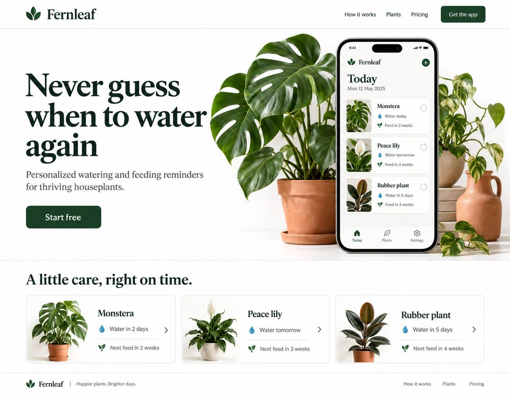
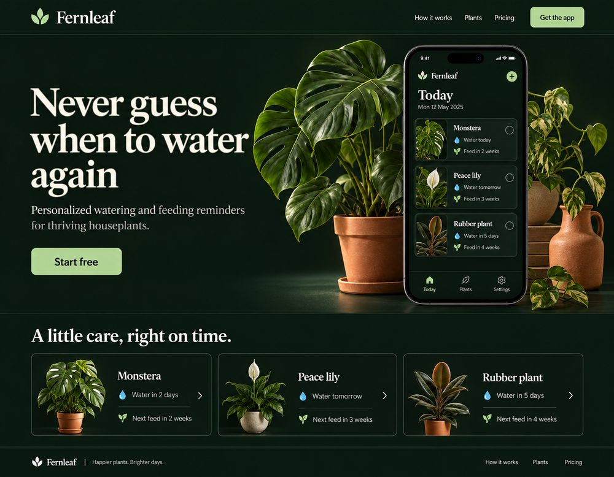
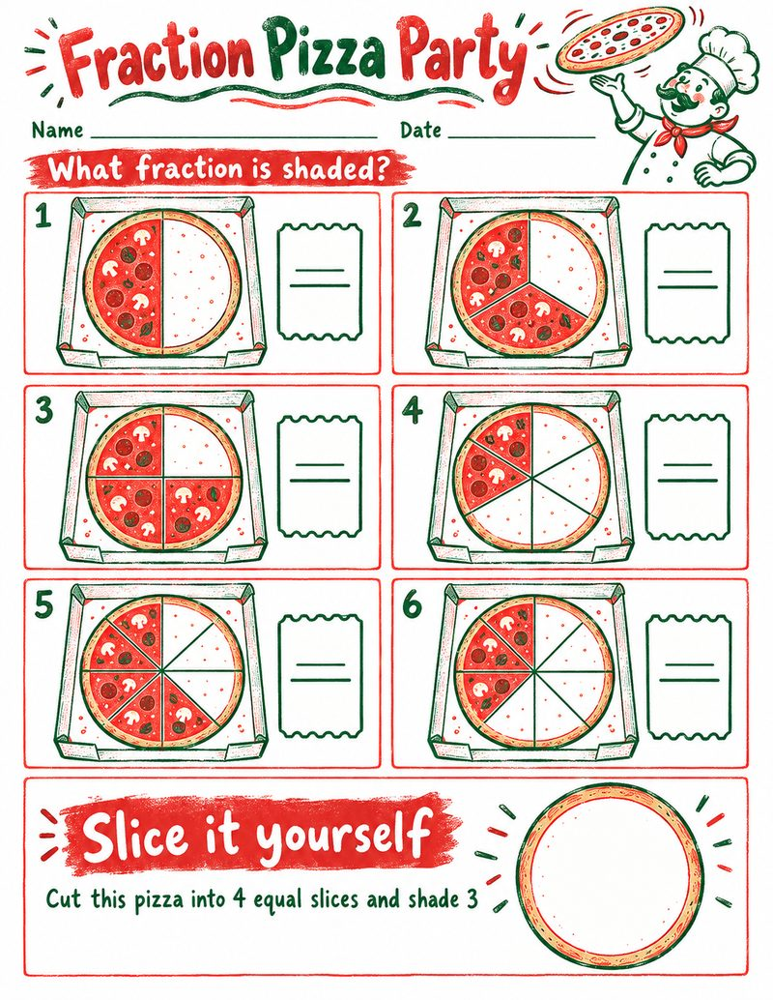

<p align="center">
  
</p>

# design: a Claude Code plugin for screen and print design

This plugin brings Codex's image-generation design workflow into Claude Code. Claude writes the
brief, OpenAI's gpt-image model draws the concept, and Claude builds the result and checks it
against the concept. The images are paid for by your ChatGPT plan, through the login Codex already
has on your machine. You need no OpenAI API key and no extra service.

> **Setting this up with an agent?** Tell it: *"Set up the design plugin from
> https://github.com/antialias/claude-design-plugin by following the agent setup in its README."*
> The [agent setup](#agent-setup) section below is written for it to follow step by step.

## What you get

| Skill | Use it for |
|---|---|
| `design:ui-concept` | Designing or redesigning a screen, page, app or game UI. It generates image concepts first, gets your approval, then implements the accepted concept and compares the build against it in a real browser. |
| `design:print-design` | Worksheets, forms, handouts, posters and printed PDFs, where page size, type and room for handwriting matter. |
| `design:imagegen` | Any raster image: mockups, illustrations, product shots, textures, sprites, transparent cutouts, and edits of existing images. The other two skills use it. |

<table>
  <tr>
    <td width="50%"></td>
    <td width="50%"></td>
  </tr>
  <tr>
    <td>A landing page concept, the first step of <code>ui-concept</code></td>
    <td>The same concept, asked for in dark mode: an edit keeps the layout and the copy</td>
  </tr>
</table>

<table>
  <tr>
    <td width="34%"></td>
    <td width="66%"></td>
  </tr>
  <tr>
    <td>A printable worksheet page</td>
    <td>A matching sticker set</td>
  </tr>
</table>

Every image on this page was drawn by this plugin from a short written brief and paid for by a
ChatGPT plan. The banner was drawn last, with the four pieces above as its reference images.

Claude picks the skills up from what you ask ("design a landing page for…", "make a printable
worksheet…", "generate an image of…"). You can also name one, for example `/design:ui-concept`.

## Requirements

- **Claude Code.**
- **Codex CLI, signed in with a ChatGPT account.** Images draw on the same plan limits as your
  Codex use.
- **uv**, which supplies the Python packages the image script needs. Nothing else is installed.
- macOS or Linux, with `bash`.

## Agent setup

These steps are for an agent setting this plugin up for a person. Run them in order. Each code
block is self-contained, so it can run as one command. Each one says
how to check it worked. If a check fails, stop and tell the person what failed, with the error
line. Do not work around a failure by switching to another image provider, an API key or a
hand-drawn placeholder.

**1. Check the tools.**

```sh
claude --version
uv --version
codex --version
```

- If `uv` is missing, ask the person before installing it. On macOS use `brew install uv`.
  Elsewhere use `curl -LsSf https://astral.sh/uv/install.sh | sh`.
- If `codex` is missing, ask the person before installing it with `npm install -g @openai/codex`.
  On macOS, `brew install --cask codex` also works.

**2. Check the Codex login.**

```sh
codex login status
test -f "${CODEX_HOME:-$HOME/.codex}/auth.json" && echo "login file present"
```

The first command must say `Logged in using ChatGPT`, and the second must print `login file present`.

- **Not logged in, or logged in with an API key.** The person has to sign in themselves, because
  it opens a browser. In Claude Code, ask them to type `! codex login` and choose to sign in with
  ChatGPT.
- **Logged in but no login file.** Codex keeps its login in the OS keyring. This plugin reads only
  the login file, so add this line near the top of `~/.codex/config.toml`, above any `[section]`:

  ```toml
  cli_auth_credentials_store = "file"
  ```

  Then ask the person to run `! codex login` again.

**3. Install the plugin.**

```sh
claude plugin marketplace add antialias/claude-design-plugin
claude plugin install design@claude-design-plugin
claude plugin list
```

The list must show `design@claude-design-plugin`. If adding the marketplace fails on an SSH
error, run the same command with `CLAUDE_CODE_PLUGIN_PREFER_HTTPS=1` in front of it.

**4. Check it without spending anything.**

```sh
W="$(ls -d ~/.claude/plugins/cache/claude-design-plugin/design/*/skills/imagegen/scripts/imagegen | sort -V | tail -1)"
echo "$W"
"$W" generate --prompt "setup check" --dry-run 2>&1 | head -1
uv run --quiet --no-project python3 "$(dirname "$W")/codex_images.py" check
```

- The first line of the dry run must say
  `imagegen: model gpt-image-2-codex (ChatGPT image tool) via Codex login`.
- The `check` command must print a model name, such as the model Codex is set to use. That model
  only hosts the image tool; the picture itself is drawn by gpt-image-2-codex.
- If `$W` is empty, the plugin did not install: go back to step 3.
- If it says `via ChatGPT subscription (switch proxy …)`, the machine has a claude-switch proxy
  configured. That is a different backend, and the person may want it. Ask them which one they
  want before going on. To force this one, add `"IMAGEGEN_BACKEND": "codex"` to the `env` object in
  `~/.claude/settings.json`, start a new session, and repeat this step.

**5. Make one real image.** This spends one image from the person's ChatGPT plan limits, so ask
first.

```sh
W="$(ls -d ~/.claude/plugins/cache/claude-design-plugin/design/*/skills/imagegen/scripts/imagegen | sort -V | tail -1)"
"$W" generate --prompt "a small red circle centred on a white background" \
  --quality low --size 1024x1024 --out /tmp/imagegen/setup-check.png
```

Read `/tmp/imagegen/setup-check.png` with the Read tool and confirm it shows a red circle. Then
delete it.

**6. Start a new Claude Code session.** Skills load when a session starts, so the person's current
session will not have them. Tell the person setup is done, and suggest a first request such as
*"Design a landing page for my project"*.

### When something fails

| The error says | What to do |
|---|---|
| `uv is not installed` | Step 1. |
| `no Codex login at …` | Step 2: sign in, or switch Codex to the login file. |
| `Codex is signed in with an API key` | Step 2: `codex login` with ChatGPT. Or use the `api` backend below. |
| `the Codex login expired at …` or `chatgpt.com refused the Codex login` | Use Codex once, with any prompt, so it refreshes its login, or run `codex login`. This plugin never refreshes the login itself, because that could sign Codex out. |
| `the ChatGPT plan's usage limit is reached` | Wait for the limit to reset. The error includes ChatGPT's own message. |
| `no model in … config.toml and no model list` | Set `IMAGEGEN_CODEX_MODEL` to a model your Codex offers, for example the one `/model` shows in Codex. |
| `the image backend answered …` | ChatGPT refused the call. Report the message. The backend may have changed; see the caveats. |

## How it works

Every image goes through one command, `skills/imagegen/scripts/imagegen`. It runs OpenAI's own
image script from Codex's imagegen skill, unmodified, and points that script at one of three
backends, chosen by `IMAGEGEN_BACKEND`:

| Backend | Pays with | How |
|---|---|---|
| `codex` (default) | your ChatGPT plan | A small loopback bridge, `codex_images.py`, answers the image script's Images API calls by asking the image tool of the backend Codex itself uses. It reads Codex's login file on each call and never writes it. |
| `subscription` | a ChatGPT plan, through a proxy | For machines running a claude-switch proxy with Images API routes. It is the default where that proxy is configured. |
| `api` | OpenAI API credits | OpenAI's Image API with `OPENAI_API_KEY`. Use it only if you want billed API usage. |

A failure on one backend never moves the call to another. On `codex` and `subscription` the image
is drawn by the ChatGPT image tool's own model, gpt-image-2-codex, whatever `--model` says, and
the command reports that model.

## Caveats

- **This uses an undocumented backend.** The `codex` backend calls the same ChatGPT endpoint the
  Codex CLI uses, but that endpoint is not a public OpenAI API. It can change or stop working
  without notice. Using your plan this way from outside Codex may also conflict with OpenAI's
  terms. Decide for yourself whether that is acceptable.
- **Images count against your Codex usage limits.**
- **The model is fixed.** You cannot pick a different image model on the ChatGPT backends; use the
  `api` backend for that.

## Updating

```sh
claude plugin marketplace update claude-design-plugin
claude plugin update design@claude-design-plugin
```

## About this repository

This repository is published automatically from a private one, where the plugin is developed.
Pull requests can't be merged here, because the next publish would overwrite them. Please open an
issue instead.

## License

Apache-2.0; see `LICENSE` and `NOTICE`. The image scripts and reference documents under
`skills/imagegen/` come from OpenAI's Codex imagegen skill, also Apache-2.0
(`skills/imagegen/LICENSE.txt`).
